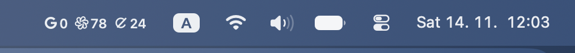

# aiBar

Ultra-compact native macOS menu bar monitor for AI subscription usage limits across **Google (Gemini)**, **Anthropic (Claude)**, **OpenAI (ChatGPT & Codex)**, and **Grok (xAI)**.



## Why aiBar

Checking how much AI quota you have left—or when your window resets—usually means switching browser tabs and digging through account settings across four different websites. **aiBar** puts your active weekly usage percentages right in the macOS menu bar as a single minimal item, with full rolling-window details and reset times one click away.

### Key Highlights

- **Minimal menu bar footprint:**
  All signed-in providers share **one compact menu bar item** (`[Icon]Number`). Only providers you are actually signed into are shown—no `%` signs, no `--` placeholders, and no wasted horizontal space.
- **At-a-glance weekly usage + smart alerts:**
  Each icon displays your current weekly usage percentage (`0`–`100`). If either your 5-hour session window or your weekly window reaches **80%+** (orange) or **90%+** (red), the number automatically highlights so you never hit a rate limit mid-task.
- **Full breakdown on click:**
  Click the menu bar item to open an auto-sized native popover showing:
  - **All quota windows:** 5-hour rolling session limits, 7-day / monthly limits, and model-specific caps (such as Claude Sonnet/Opus, Codex Spark, or Grok Build & On-Demand pools).
  - **Exact credit reset times:** live countdowns (`Resets in 2h 14m`) alongside local clock times (`Today 17:45` or `Thu, Nov 19, 14:00`).
  - **One-click web shortcuts:** jump straight to each provider's **Usage** dashboard or **Settings** page in your browser.
- **Effortless sign-in:**
  - **Zero-click local detection:** automatically picks up existing local sign-ins if you already use `grok` CLI, OpenCode, Claude Code, or Codex CLI on your Mac.
  - **Built-in Web Sign-In:** sign in directly inside `aiBar` for Google, Anthropic, OpenAI, or Grok (supports Google/Apple SSO popups and `⌘+Tab` switching for 2FA codes).
  - **Manual Token / Cookie option:** optionally paste a token or cookie stored securely in your macOS Login Keychain.
- **100% Native & Private:**
  Written in pure Swift and AppKit (~3 MB binary, no Electron, no Dock icon). Zero analytics, zero telemetry—your credentials never leave your Mac.

---

## Supported Providers

| Provider | Menu Bar Metric | Popover Details |
| :--- | :--- | :--- |
| **Google** *(Gemini)* | 7-Day Weekly % | 5-Hour window, 7-Day weekly window, Overage AI Credits, reset times |
| **Anthropic** *(Claude)* | 7-Day Weekly % | 5-Hour session, 7-Day weekly, Sonnet/Opus scoped limits, Extra Usage, reset times |
| **OpenAI** *(ChatGPT & Codex)* | 7-Day / 30-Day % | 5-Hour window, 7-Day / 30-Day window, Spark limits, Reset Credits, reset times |
| **Grok** *(xAI SuperGrok)* | Grok Build 7-Day % | Grok Build & Total Pool usage, On-Demand cap, Prepaid balance, reset times |

> Prefer seeing **remaining free %** instead of **consumed usage %**? Open **aiBar Settings** (`⌘,`) and switch *Menu bar numbers show* between **Usage % (consumed)** and **Free % (remaining)**.

---

## Install

Requires **macOS 14 (Sonoma)** or newer (Universal binary: Apple Silicon & Intel).

### Option 1: One-Line Terminal Install *(Recommended)*

Paste this into **Terminal** to download the latest Universal release, verify its SHA-256 checksum, install `aiBar.app` into `/Applications` (no `sudo` needed), and launch it immediately without browser Gatekeeper prompts:

```bash
curl -fsSL https://raw.githubusercontent.com/lubino/aiBar/main/install.sh | bash
```

To update `aiBar` later, run the same command again. To uninstall:

```bash
curl -fsSL https://raw.githubusercontent.com/lubino/aiBar/main/install.sh | bash -s -- --uninstall
```

### Option 2: Download `.dmg` from GitHub Releases

1. Download **`aiBar.dmg`** from the **[Latest GitHub Release](https://github.com/lubino/aiBar/releases/latest)**.
2. Open `aiBar.dmg` and drag **`aiBar.app`** into **`Applications`**.
3. *First-launch note:* `aiBar` is open-source and ad-hoc signed rather than notarized with a paid Apple Developer ID. If macOS Gatekeeper blocks a browser-downloaded `.dmg`, either choose **Open Anyway** in **System Settings → Privacy & Security**, or clear the browser quarantine attribute once in Terminal:
   ```bash
   xattr -cr /Applications/aiBar.app && open /Applications/aiBar.app
   ```

### Option 3: Build from Source

Only **macOS Command Line Tools** (`xcode-select --install`) with Swift 6+ are required—full Xcode is not needed:

```bash
curl -fsSL https://raw.githubusercontent.com/lubino/aiBar/main/install.sh | bash -s -- --from-source
```

Or manually from a local clone:

```bash
git clone https://github.com/lubino/aiBar.git
cd aiBar
./scripts/package-dmg.sh   # produces build/aiBar.app, build/aiBar.dmg, and build/aiBar-macos.zip
```

---

## Usage

1. Launch **aiBar**. If you already have a supported CLI signed in on your Mac, its usage appears in the menu bar immediately.
2. Click the **aiBar** menu bar item to view active quotas or connect additional providers under **Connect Providers → Sign In…**.
3. Use the **Usage ↗** and **Settings ↗** buttons on any provider card to open that service's web dashboard directly.
4. Click the **gear icon** (`⌘,`) in the popover footer to toggle providers, change the refresh interval (`2` / `5` / `15` / `30` minutes), switch between *Usage %* and *Free %*, or enable **Launch aiBar at Login**.

---

## Privacy & Storage

- Non-secret preferences are saved in `~/.config/aibar/config.json` (`0600`).
- Cached quota snapshots (percentages and reset timestamps) are saved in `~/.config/aibar/snapshots.json` (`0600`) for instant startup display.
- Manual tokens/cookies and refreshed OAuth tokens are stored exclusively in the **macOS Login Keychain** (`sk.lubino.aiBar`).

## License

[GNU General Public License v3.0](./LICENSE) (`GPL-3.0-only`)
